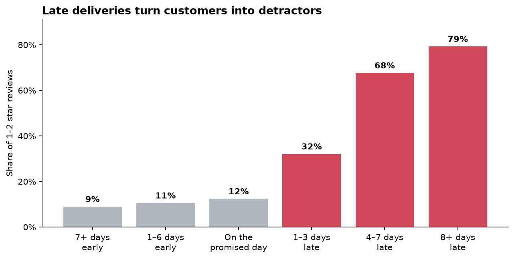
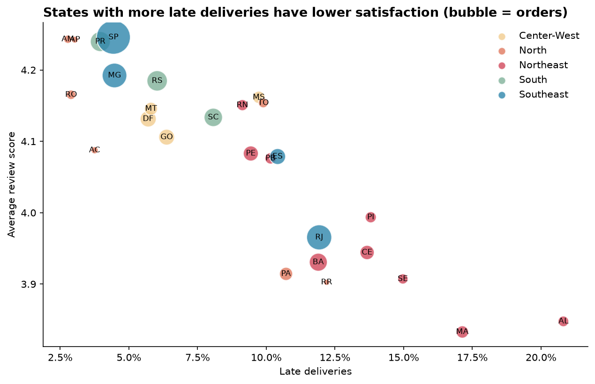
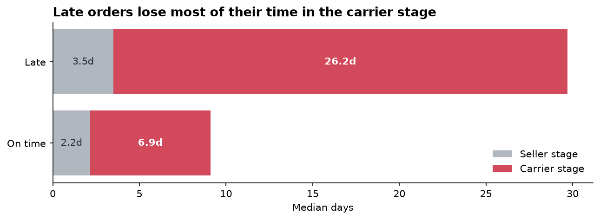
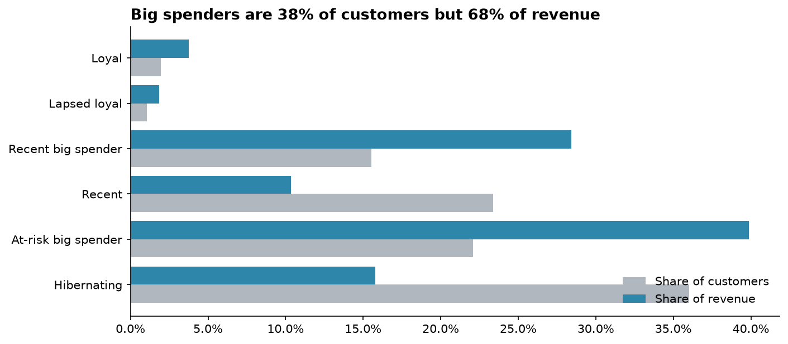
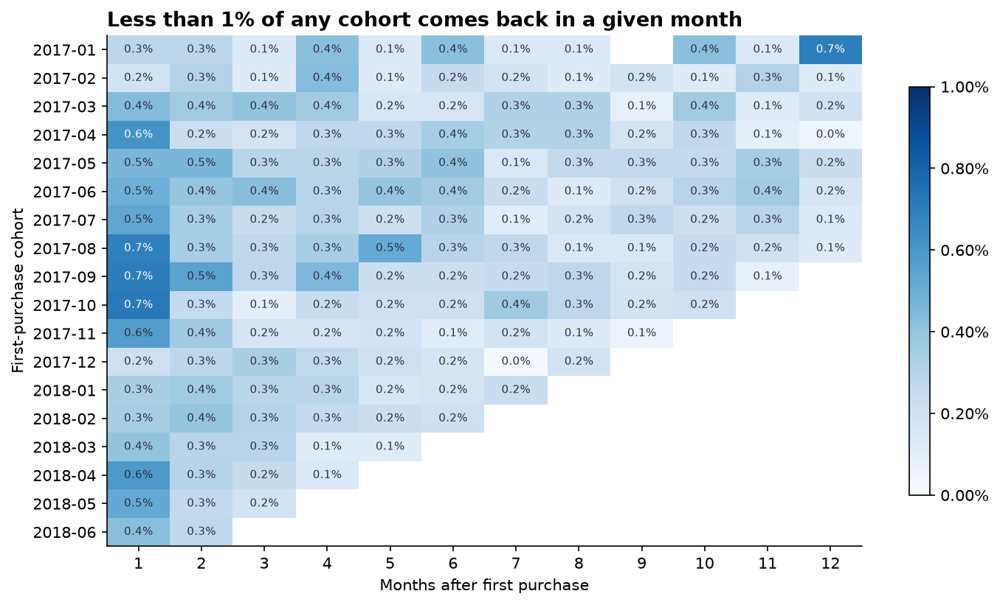
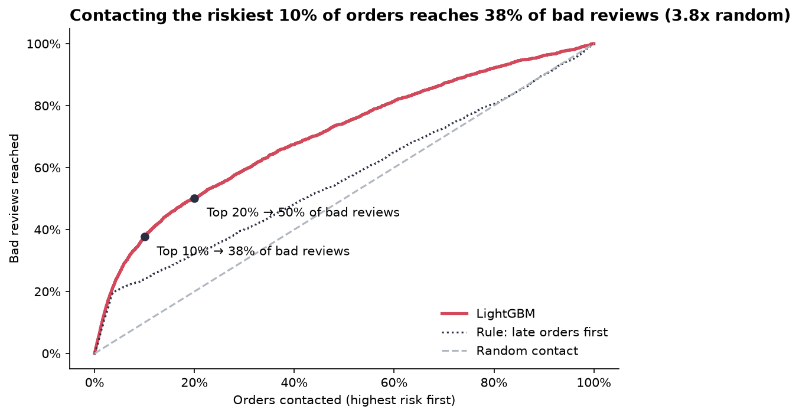
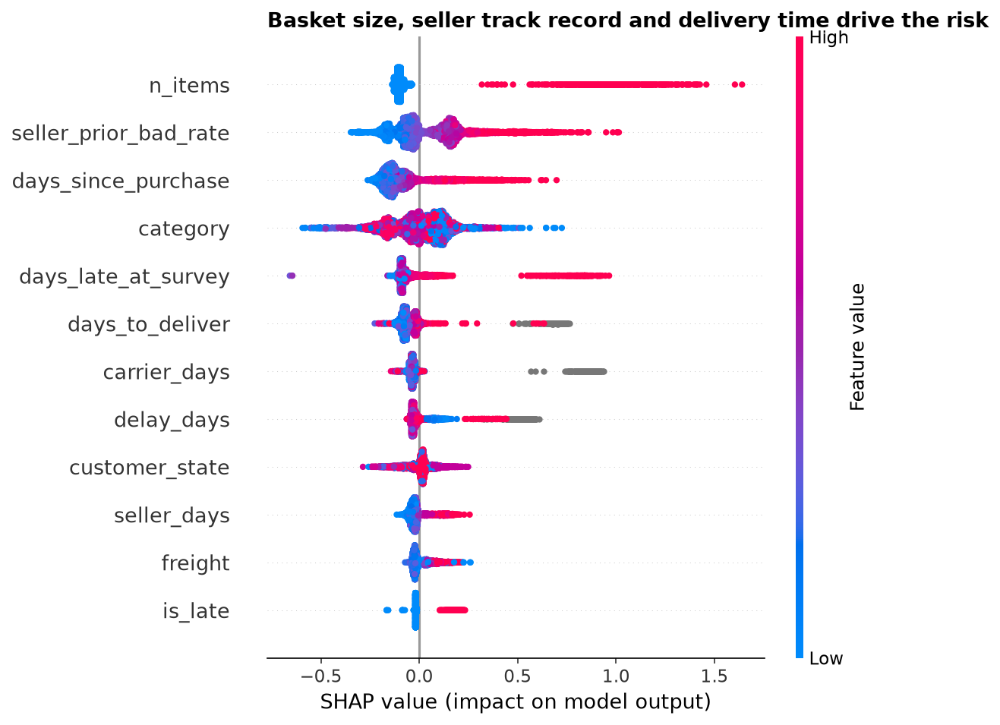
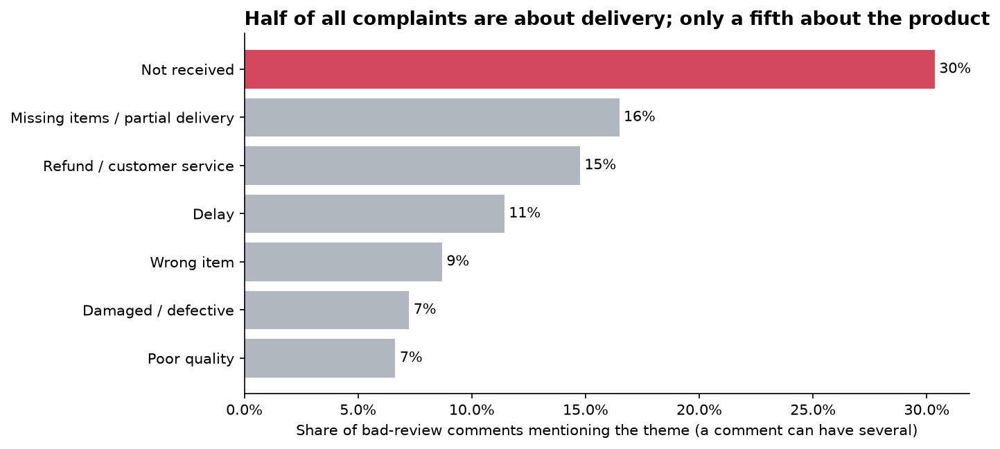
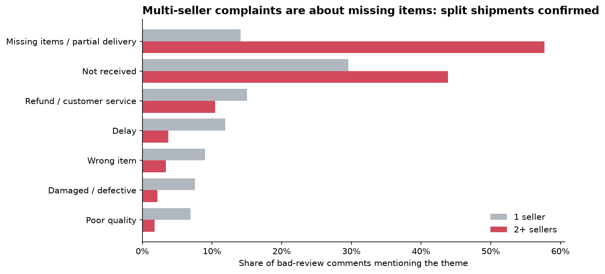

# Olist Customer Analytics

**Why do customers of a Brazilian marketplace leave bad reviews, who are the valuable customers, and what should the business fix first?**

End-to-end data science project on ~100k orders from [Olist](https://www.kaggle.com/datasets/olistbr/brazilian-ecommerce) (2016–2018): SQL analysis, statistical testing, customer segmentation, a leakage-safe machine-learning model, Portuguese NLP and a deployed dashboard with business recommendations.

**[▶ Live dashboard](https://olist-customer-analytics01.streamlit.app/)** · [Notebooks](notebooks/) · [SQL](sql/)



---

## Executive summary

| # | Finding | Evidence |
|---|---|---|
| 1 | **Late deliveries drive bad reviews.** | A late order gets a 1–2★ review 62% of the time vs 9% on time: **6.7x the risk** (95% CI 6.6–6.9, p < 0.001). The effect holds in all 21 states with enough late orders (odds ratio 15.6 after controlling for state). |
| 2 | **The carrier is the bottleneck, and the Northeast suffers most.** | Late orders spend a median **26 days with the carrier** vs 7 for on-time orders. Alagoas and Maranhão have 4–5x São Paulo's late rate. |
| 3 | **Half of all complaints are about delivery, not the product.** | 50.5% of bad-review comments mention delivery vs 20.8% the product. The #1 theme is **"not received" (30%)**, on orders marked as *delivered*. |
| 4 | **Split shipments are a hidden problem.** | Orders with 2+ sellers get **47% bad reviews even when on time**; 58% of their complaints mention missing items. |
| 5 | **A model can prioritise customer-service contacts.** | Contacting the riskiest **10%** of delivered orders reaches **30% of bad reviews (3x random)**, on unseen months. |
| 6 | **Almost nobody comes back.** | Only **3%** of customers buy twice. "At-risk big spenders" (22% of customers) hold **40% of revenue**. |

### Recommendations

1. **Carrier SLAs and monitoring, starting with the Northeast.** Late deliveries account for up to **28% of all bad reviews**.
2. **Proof of delivery (photo or signature) and carrier audits**, to tackle "delivered but not received".
3. **Fix split shipments:** warn customers, track each parcel, and mark an order delivered only when everything has arrived. Multi-item orders account for up to **12% of bad reviews**.
4. **Proactive customer-service contacts** driven by the risk model.
5. **Win-back campaign** for at-risk big spenders, plus a **second-purchase programme**.

*"Up to" figures are upper bounds: the bad reviews that would disappear if the problem group had the same bad-review rate as all other orders. The data are observational, so effects are associations, not proven causes.*

---

## Results in more detail

### 1. Logistics and satisfaction ([notebook 02](notebooks/02_eda_logistics.ipynb))

| | |
|---|---|
|  |  |

- Promised delivery times are padded (23.7 days promised vs 12.6 actual), yet 6.8% of orders still arrive late.
- Across states, late rate and average review are strongly correlated (r = −0.88).
- Checks: chi-square test, relative risk with confidence interval, Mann-Whitney U, and a logistic regression controlling for state to rule out regional confounding.

### 2. Customers ([notebook 03](notebooks/03_customers.ipynb))

| | |
|---|---|
|  |  |

- Classic RFM quintiles break on Frequency (97% of customers have one order), so Frequency became a repeat-customer flag.
- K-Means (k = 4, chosen with elbow and silhouette plus business judgement) agrees closely with the rule-based segments.
- A bad first experience lowers the return rate only slightly and **not significantly** (1.60% vs 1.97%, p = 0.135). Retention is low for everyone, so it needs active levers.

### 3. Bad-review risk model ([notebook 04](notebooks/04_bad_review_model.ipynb))

| | |
|---|---|
|  |  |

| Model (test: May–Aug 2018) | PR-AUC | Lift @ top 10% |
|---|---|---|
| Random baseline | 0.085 | 1.0x |
| Logistic regression | 0.198 | 2.9x |
| Decision tree (depth 5) | 0.183 | 2.8x |
| **LightGBM** | **0.207** | **3.0x** |

**How leakage was avoided:**
- The prediction is made **right after delivery**, using only information known at that moment.
- Reviews written *before* delivery are excluded.
- The seller's past bad-review rate is computed with a **time-aware join** (`merge_asof`).
- The split is **time-based**, and the test set was used once.

The model is useful but modest. Many bad reviews come from causes that are not in the structured data, which motivated the text analysis.

### 4. What customers say ([notebook 05](notebooks/05_review_text.ipynb))

| | |
|---|---|
|  |  |

- A **TF-IDF + logistic regression** classifier trained on the review scores reaches **PR-AUC 0.80** (ROC-AUC 0.95) on unseen months. It is light, explainable and runs live in the dashboard.
- Complaint themes (regular expressions written from real comments) were validated with **NMF topic modelling** and a sanity check (late orders mention delay far more often).

---

## Method

The project follows **CRISP-DM**:

| Phase | Work |
|---|---|
| Business understanding | Retention problem; reviews as a reputation and acquisition driver |
| Data understanding | SQL on 9 tables: JOINs, CTEs, window functions (`ROW_NUMBER`, `LAG`/`LEAD`, running totals) |
| Data preparation | One-row-per-order dataset, deduplicated reviews, data-quality filters, leakage-safe features |
| Modeling | RFM + K-Means, LightGBM risk model, text classifier, NMF topics |
| Evaluation | Hypothesis tests, time-based validation, PR-AUC and lift, SHAP |
| Deployment | Streamlit dashboard on Streamlit Community Cloud |

**Stack:** Python (pandas, scikit-learn, LightGBM, SHAP, statsmodels, SciPy), SQL (SQLite), Plotly, Matplotlib, Streamlit.

## Project structure

```
├── app/                    Streamlit dashboard (small aggregated data + trained models)
├── notebooks/              02 EDA · 03 customers · 04 risk model · 05 review text
├── reports/figures/        Charts used in this README
├── sql/                    01–06 analysis queries
├── src/
│   ├── load_data.py        CSVs → SQLite (with indexes)
│   ├── build_datasets.py   SQL → data/processed/orders.parquet
│   ├── features.py         Leakage-safe model features
│   ├── text.py             Portuguese text normalisation and complaint themes
│   └── build_app_data.py   Aggregated files for the dashboard
└── ROADMAP.md
```

## Reproduce

1. Download the [Olist dataset](https://www.kaggle.com/datasets/olistbr/brazilian-ecommerce) and unzip the CSV files into `data/raw/`.
2. Run:

```bash
python3 -m venv .venv
.venv/bin/pip install -r requirements.txt

.venv/bin/python src/load_data.py          # CSVs → data/olist.db
.venv/bin/python src/build_datasets.py     # → data/processed/orders.parquet
# run notebooks 02 → 05 in order (they save processed data and models)
cd src && ../.venv/bin/python build_app_data.py && cd ..
.venv/bin/streamlit run app/streamlit_app.py
```

## Limitations and next steps

- **Observational data:** effects are strong and consistent, but an A/B test (for example, proactive contact vs none) would be needed to prove causality and measure the real impact.
- **Time window:** the data end in 2018, so the models would need retraining on recent data before real use.
- **Next steps:** delivery-time prediction at purchase (to set better promises), CLV modelling, and a transformer-based text model to compare against TF-IDF.

---

Data: Olist Brazilian E-commerce Public Dataset (Kaggle, CC BY-NC-SA 4.0). Code: MIT License.
Author: **Bruno Almeida**, MBA in Data Science candidate.
